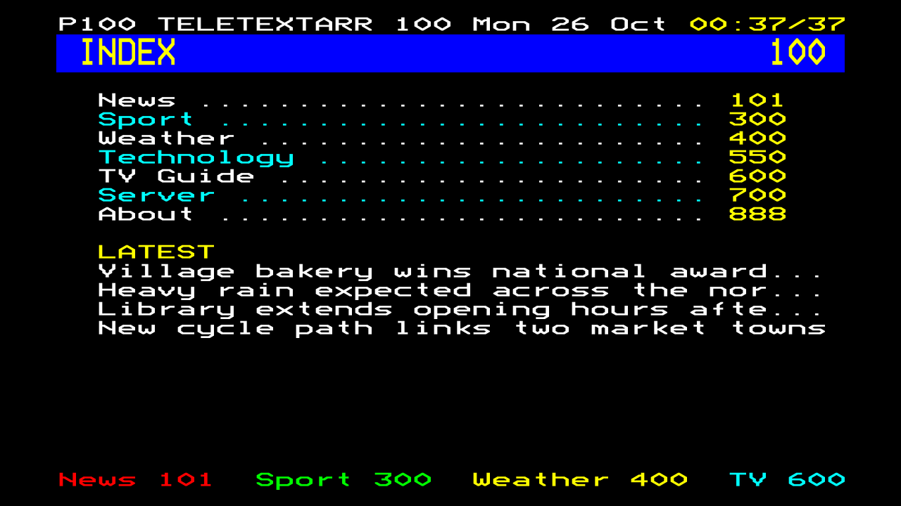
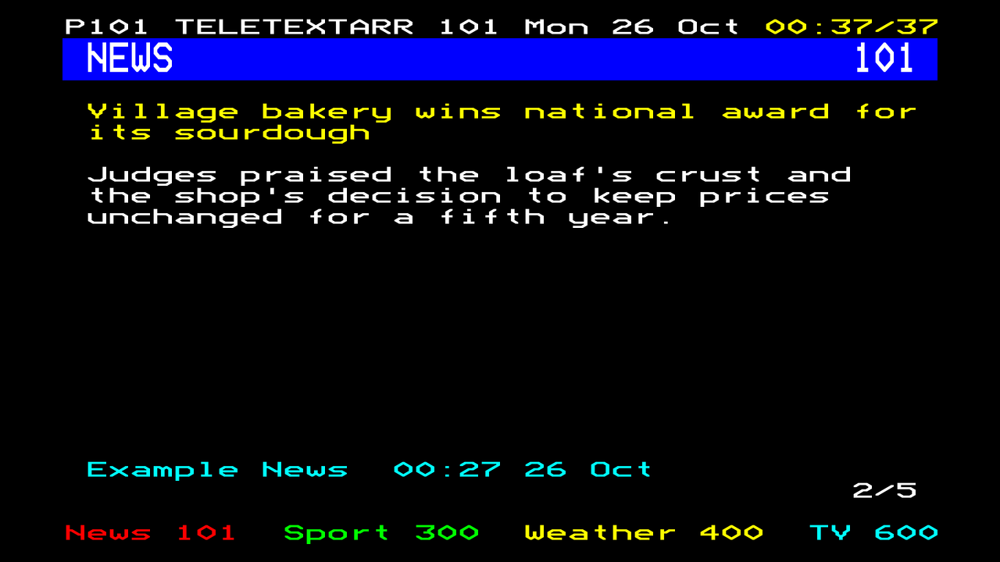
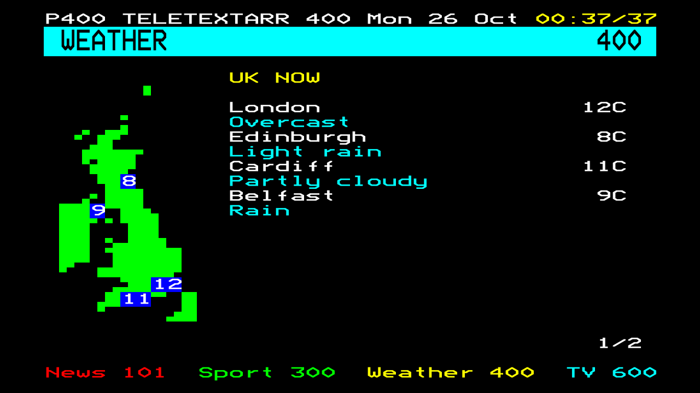
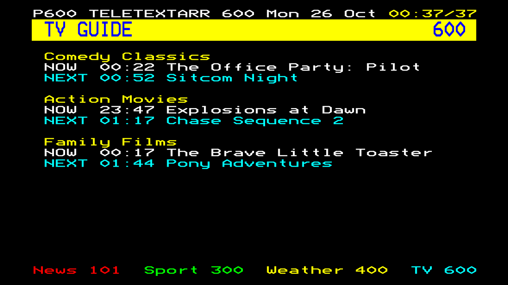
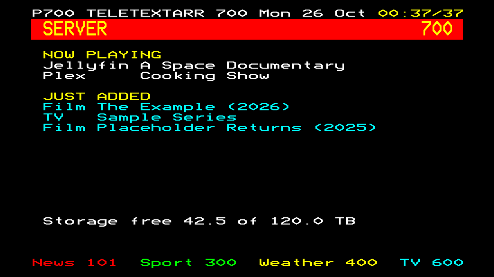

# Teletextarr

Teletext-style pages as live TV channels for **Plex** and **Jellyfin**.

Teletextarr turns RSS feeds, a weather forecast, your TV listings and your media server's status into
40×25 teletext screens, then serves each page as a live TV channel. The page number is the channel number,
so you flip pages with the remote's channel buttons or by typing a number, just like the real thing.
It works in every Plex and Jellyfin app, including TV apps and consoles, because to them it's just another tuner.



| | |
|---|---|
|  |  |
|  |  |

## Features

- **Configurable pages**: build your own set from RSS/Atom feeds, weather, XMLTV listings, media server status and static text.
- **Carousel subpages**: the first subpage lists the headlines, then each story gets its own subpage, cycling like the real carousel.
- **Plex and Jellyfin support**: emulates an HDHomeRun tuner and also serves an M3U playlist and XMLTV guide.
- **Weather maps**: a mosaic-block map of any country with live temperatures, like the old weather pages.
- **Authentic look**: the 40×25 grid, the eight teletext colours, double-height titles, a ticking clock, the coloured shortcut (Fastext) row, and the [Bedstead](https://bjh21.me.uk/bedstead/) font.
- **Light on power**: nothing is encoded until someone tunes in, and a page is a still image most of the time, so a stream is around 350 kbps and costs very little CPU.

## Quick start

```sh
git clone <this repo> teletextarr && cd teletextarr
cp config.example.yaml config.yaml        # set server.base_url and your pages
docker compose -f docker-compose.example.yml up -d --build
docker compose -f docker-compose.example.yml run --rm teletextarr python -m teletextarr --check
```

Open `http://<host>:8098/preview/100.png` to see a page without a TV.

### Add to Plex

**Settings → Live TV & DVR → Set up Plex DVR**, then enter the device address manually: `http://<host>:8098`.
When it asks for a guide, choose **Have an XMLTV guide on your server?** and use `http://<host>:8098/xmltv.xml`.

### Add to Jellyfin

**Dashboard → Live TV**:

1. **Tuner devices → +**, type **M3U Tuner**, file or URL `http://<host>:8098/channels.m3u`.
2. **TV guide data providers → + → XMLTV**, path `http://<host>:8098/xmltv.xml`. Under the tuner selection, tick only the Teletextarr tuner.

Jellyfin matches the channels to the guide by ID automatically.

## Configuration

Everything lives in `config.yaml`. See [`config.example.yaml`](config.example.yaml) for a commented example.
Anything written as `${NAME}` is read from the environment, so secrets stay out of the file.

### `server`

| Key | Default | |
|---|---|---|
| `base_url` | required | The address Plex/Jellyfin use to reach Teletextarr. Must work from inside their containers. |
| `port` | `8098` | Listening port. |
| `device_id` | `54545852` | 8 hex characters. Plex identifies tuners by this ID, so don't change it after setup. |
| `tuner_count` | `4` | How many people can watch at once. |
| `user_agent` | `Teletextarr/<version>` | Sent when fetching feeds. |

### `display`

| Key | Default | |
|---|---|---|
| `brand` | `TELETEXTARR` | Shown in the header row (up to 11 characters) and in channel names. |
| `channel_name` | `{brand} {title}` | How channels are named in Plex/Jellyfin. Placeholders: `{brand}`, `{title}`, `{number}`. |
| `timezone` | `UTC` | IANA name, e.g. `Europe/London`. |
| `story_seconds` | `12` | How long each subpage is shown. |
| `index_seconds` | `15` | The same, for index pages. |
| `fastext` | none | Up to four `{label, page, colour}` entries for the coloured row. They must fit in 40 characters. |

### `pages`

Every page takes `number` (100–899, also the channel number), `title`, `type`, `background`, `text` and
`refresh_minutes`. Optional `banner` sets the double-height label at the top of the page (the title in
capitals by default), and `channel_name` overrides `display.channel_name` for that page. The colours are `black`, `red`, `green`, `yellow`, `blue`, `magenta`, `cyan` and `white`.

| Type | Options |
|---|---|
| `index` | `headlines_from`: the page number of an `rss` page whose top stories appear under the page list. |
| `rss` | `feeds`: a list of `{name, url}` entries. `max_stories` defaults to 8. Feeds are merged and shown newest first. |
| `weather` | `locations`: a list of `{name, latitude, longitude}`, each shown on its own subpage (a single `location` also works). `days` is 1–7 (default 5). `units: {temperature: celsius\|fahrenheit, wind: mph\|kmh\|ms\|kn}`. `details`: any of `feels_like`, `wind`, `humidity`. Optional `map: {country, places, title, neighbours}` adds a Ceefax-style mosaic map as the first subpage, with current temperatures for each place (`places` defaults to `locations`; `country` is an ISO code or name). Uses [Open-Meteo](https://open-meteo.com), which needs no key. |
| `xmltv` | `url` of any XMLTV guide (Tunarr, ErsatzTV, …). `channels_per_screen` defaults to 5. |
| `media_server` | `jellyfin: {url, api_key}` and/or `plex: {url, token}`. `show_now_playing` defaults to true and shows titles only, never usernames. `disk_path` is a mounted path whose free space is shown. |
| `text` | `lines`: strings or `{text, colour}` entries. |

## How it works

```
feeds / weather / XMLTV / Jellyfin / Plex
        │  (background refresh per page)
        ▼
   page builders ──► 40×25 screens ──► Pillow + Bedstead ──► 1 fps frames
                                                                  │
                    Plex / Jellyfin ◄── MPEG-TS ◄── ffmpeg (x264, 25 fps, silent AAC)
```

| Endpoint | Purpose |
|---|---|
| `/discover.json`, `/lineup.json`, `/lineup_status.json` | HDHomeRun emulation, used by Plex |
| `/channels.m3u` | M3U playlist, used by Jellyfin |
| `/xmltv.xml` | Guide data: each page appears as an hourly listing |
| `/stream/<page>` | The live MPEG-TS stream for a page |
| `/preview/<page>.png` | The page's current frame as a PNG |
| `/health` | Health check |

Every viewer of a page sees the same subpage at the same time, because the carousel runs off the wall clock.

## Development

```sh
python -m venv .venv && .venv/bin/pip install -r requirements.txt -r requirements-dev.txt
.venv/bin/python -m pytest
.venv/bin/python -m teletextarr --config config.yaml    # needs ffmpeg on PATH for streams
```

## Notes

- **Feed content** belongs to its publishers. Check each feed's terms of use; many allow personal, non-commercial use only.
- Teletextarr isn't affiliated with the BBC or any broadcaster. Ceefax was the BBC's teletext service, and this project is a tribute to the format.

## Credits

- [Bedstead](https://bjh21.me.uk/bedstead/) by Ben Harris, released under CC0. The font is in `fonts/` with its licence.
- Weather data from [Open-Meteo](https://open-meteo.com) (CC BY 4.0).
- Country outlines from [Natural Earth](https://www.naturalearthdata.com) (public domain), rebuilt with `scripts/build_countries.py`.

## Licence

[MIT](LICENSE)
